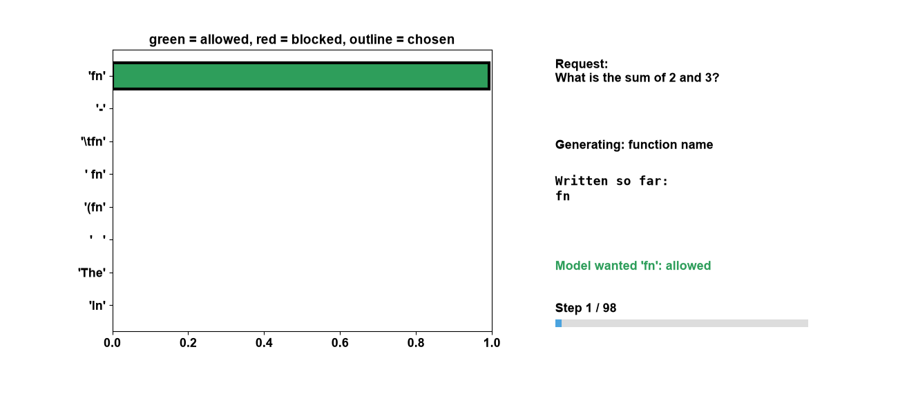

*This project has been created as part of the 42 curriculum by bmelikse.*

# 📞 Call Me Maybe

Function calling with a tiny LLM: natural-language requests go in, structured function calls (a function name plus correctly typed arguments) come out. A 0.6B-parameter model is guided token by token with **constrained decoding**, so every output is valid JSON by construction.

<p align="center">
  
</p>

---

## Table of Contents

- [Description](#description)
- [Results](#results)
- [Instructions](#instructions)
- [Input and output format](#input-and-output-format)
- [How it works](#how-it-works)
- [Design decisions](#design-decisions)
- [Performance analysis](#performance-analysis)
- [Challenges faced](#challenges-faced)
- [Testing strategy](#testing-strategy)
- [Error handling](#error-handling)
- [Known limitations](#known-limitations)
- [Bonus: visualization of the generation](#bonus-visualization-of-the-generation)
- [Project structure](#project-structure)
- [Resources](#resources)

---

## Description

Given a request like *"What is the sum of 40 and 2?"*, a normal LLM answers `42`. This project does something different: it **does not answer the question**, it returns the call that would answer it.

```json
{"prompt": "What is the sum of 40 and 2?", "name": "fn_add_numbers", "parameters": {"a": 40.0, "b": 2.0}}
```

This is how AI assistants use tools (calculators, calendars, APIs): the model works out *what* to call and with *which arguments*, and ordinary code does the actual work. Nothing is executed here; the program only produces the call.

The difficulty is that small models are bad at producing strict formats. Asked for JSON, a 0.6B model will often add prose, forget a bracket or invent a function. Instead of hoping the prompt is enough, this project intervenes in the generation itself:

- at every step the model scores all ~150,000 tokens of its vocabulary (the **logits**);
- the program sets the score of every token that would break the format to `-inf`;
- the best remaining token is chosen.

Because invalid tokens can never be picked, the model can only produce valid function names and well-typed values. The model still makes the real decisions (which function, which values); the program only decides what is *allowed*.

Main features:

- the function is chosen **by the LLM**, never by keyword rules or other heuristics;
- argument values are generated under per-type constraints (`number`, `integer`, `boolean`, `string`);
- the JSON structure is written by Python, never by the model, so the output is always parseable;
- greedy decoding, so the same input always gives the same output;
- every data structure is validated with `pydantic`;
- a matplotlib visualizer that shows, step by step, what the model wanted and what the constraints allowed (bonus).

---

## Results

| Set | Tests | Passed |
|---|---:|---:|
| Public set (the 11 provided prompts, checked with the moulinette) | 11 | **11 / 11** |
| Private set (moulinette `--set private`, different functions) | 11 | **9 / 11** |

| Metric | Result |
|---|---|
| Output validity | 100% valid JSON (guaranteed by construction) |
| Speed | all 11 prompts in about **100 seconds** on **42 School iMac Ubuntu workstation (Intel Core i5-8500 @ 3.00GHz, 8GB RAM)** (limit: 5 minutes) |
| Model | `Qwen/Qwen3-0.6B` |

The two private-set failures are model accuracy limits, not decoding bugs (see [Known limitations](#known-limitations)).

---

## Instructions

### Requirements

- Python 3.10 or newer
- [`uv`](https://docs.astral.sh/uv/)
- Internet access on the **first** run: the model (about 1 to 1.5 GB) is downloaded from Hugging Face and cached

### Installation

```bash
git clone <your_repo_url>
cd <repo>
make install        # runs `uv sync`
```

> **Tip for 42 school machines:** the packages (`torch` and friends) and the model take several GB. If your home folder is small, point the caches somewhere roomier *before* installing, for example:
>
> ```bash
> export HF_HOME=/sgoinfre/<login>/hf_home
> export UV_CACHE_DIR=/sgoinfre/<login>/uv_cache
> ```

### Running

```bash
make run
# or, with custom paths:
uv run python -m src \
    --functions_definition data/input/functions_definition.json \
    --input data/input/function_calling_tests.json \
    --output data/output/function_calls.json
```

All three options are optional; the values above are the defaults. The output directory is created if it does not exist.

| Option | Meaning |
|---|---|
| `--functions_definition <file>` | JSON file describing the available functions |
| `--input <file>` | JSON file with the prompts to translate |
| `--output <file>` | Where the resulting JSON is written |
| `--visualize` | Open the step-by-step visualization window (bonus) |
| `--gif <file>` | Save the visualization as a GIF instead of opening a window (bonus) |

### Makefile targets

| Target | Effect |
|---|---|
| `make install` | Install the dependencies with `uv sync` |
| `make run` | Run the program with the default paths |
| `make visualize` | Run the program with the default paths & visualize it |
| `make debug` | Run the program under `pdb` |
| `make lint` | `flake8` + `mypy` with the flags required by the subject |
| `make lint-strict` | `flake8` + `mypy --strict` |
| `make clean` | Remove `__pycache__`, `.mypy_cache` and other caches |

---

## Input and output format

**`functions_definition.json`**: the "menu" the model chooses from. It also provides the type rules used during decoding.

```json
[
  {
    "name": "fn_add_numbers",
    "description": "Add two numbers together and return their sum.",
    "parameters": {"a": {"type": "number"}, "b": {"type": "number"}},
    "returns": {"type": "number"}
  }
]
```

**`function_calling_tests.json`**: the requests.

```json
[{"prompt": "What is the sum of 265 and 345?"}]
```

**Output** (`function_calls.json`): one object per prompt with exactly the keys `prompt`, `name` and `parameters`. Parameters follow the order and types of the definition, and `number` values are always floats (`2.0`, never `2`).

```json
[
  {
    "prompt": "What is the sum of 265 and 345?",
    "name": "fn_add_numbers",
    "parameters": {"a": 265.0, "b": 345.0}
  },
  {
    "prompt": "Replace all vowels in 'Programming is fun' with asterisks",
    "name": "fn_substitute_string_with_regex",
    "parameters": {
      "source_string": "Programming is fun",
      "regex": "([aeiou])",
      "replacement": "*"
    }
  }
]
```

Supported parameter types: `number`, `integer`, `boolean` and `string`.

---

## How it works

### The generation loop in one picture

```
 prompt ─▶ tokens ─▶ LLM ─▶ logits (one score per token)
                                 │
                       + mask    │   0 = allowed, -inf = forbidden
                                 ▼
                         argmax of the allowed ─▶ next token ─▶ (append, repeat)
```

The model is only ever called through three public SDK methods: `encode`, `decode` and `get_logits_from_input_ids`. No private attribute of the SDK is used, and `torch` / `transformers` are never imported by this project's code.

### Step 0: preparation (once per run)

- **`token_texts`**: every token ID is decoded once (`decode([id])`), so the program knows the real text each token would add. (The raw vocabulary file stores spaces and newlines as special symbols, so decoding is more reliable.)
- **Masks and candidate lists** are built once from `token_texts`: the IDs of number-like tokens, of newline tokens, and a fixed mask for strings. Scanning ~150k tokens at every step would be far too slow, so every later step only touches a short list.

### Step 1: choosing the function

The prompt lists every function (name, parameter types, description), a short instruction, a worked example and the request. The model then has to *spell* the function name, one token at a time:

1. look at the text typed so far;
2. allow only the tokens that keep the text a **prefix of some valid function name**;
3. pick the best-scoring allowed token.

The loop ends when the typed text is a complete name. Choosing a name is therefore not a keyword rule: all valid names are always possible and the model's scores decide between them. If one name is the beginning of another (for example `fn_greet` and `fn_greet_formally`), the model is also allowed to emit a newline once the shorter name is complete, which means "stop here".

### Step 2: filling in the arguments

Once the function is known, a **second, shorter prompt** is built from only that function (its signature, its description, a made-up worked example and the request). Then, for each parameter *in the order of the definition*, the program writes `name = ` and lets the model produce the value under a type-specific constraint:

| Type | What is allowed | When it stops |
|---|---|---|
| `number` | tokens that keep the text a valid number (`-?digits[.digits]`) | once the number is complete and the model's favorite next token is not part of a number |
| `integer` | same, without the decimal point | same |
| `boolean` | the words `true` and `false` (spelled like a function name) | when one of them is complete |
| `string` | almost any text token; blocked: empty tokens, newlines, half-written multi-byte characters and repeated-punctuation shortcut tokens such as `****` | when the model writes a closing quote followed by a newline (a quote in the middle of text is just text); capped at 60 tokens |

Numbers are kept as text while they are generated and converted only at the end (`int(...)` or `float(...)`), so large integers keep every digit.

### Step 3: building the output

The result is a `FunctionCall` pydantic object (`prompt`, `name`, `parameters`) and the list of calls is written with `json.dump`. The model never writes a brace, comma or quote of the JSON structure, so the file is valid regardless of what the model "wants" to say.

### Why this guarantees valid output

- the function name can only be one of the defined names;
- every value can only be made of characters that are valid for its type;
- all JSON syntax and escaping is done by Python, not by the model;
- every loop has a hard step limit, so generation can never run forever.

---

## Design decisions

- **Python writes the structure, the model makes the decisions.** The first version let the model write the whole JSON character by character. It was slow (150+ model calls per prompt) and fragile. Now the model is only called for the few decisions that need language understanding, which is about ten times fewer calls.
- **Two stages with two prompts.** The name step needs the full function list; the argument step only needs the chosen function. The shorter argument prompt is faster, and anything added to it (such as examples) cannot influence which function was chosen.
- **No heuristics.** There are no keyword rules for choosing a function or extracting arguments. An early prototype had some, but they were implemented as a demo & removed because the subject requires the LLM to decide, and because they would break on any function list other than the provided one.
- **Token-level constraints, not character-level.** A token can be several characters long and may include a leading space or a quote glued to a newline. All checks ("is this still a valid prefix?") are done on the text a token would *add*, and on the model's own favorite token, not on an exact next character.
- **Precomputed candidate lists.** Candidate tokens are filtered once, so each decoding step loops over a short list instead of the whole vocabulary.
- **Greedy decoding.** Always taking the best allowed token makes results deterministic and repeatable.
- **Type-driven, not function-driven.** The engine only knows types. It works for any function definition made of the supported types, not just the provided examples.
- **Pydantic everywhere.** Definitions, prompts, outputs and the recorded visualization steps are `BaseModel` classes. The only non-pydantic class is the `InputError` exception.
- **A failing prompt never kills the run.** Each prompt is processed in its own `try` block; on failure a warning is printed and the other prompts continue.

---

## Performance analysis

- **Accuracy:** 11/11 on the public set and 9/11 (81.8%) on the private set. Function selection was correct on every prompt of both sets; the private-set misses are argument values (see below).
- **Speed:** every model call re-reads the whole prompt, because the SDK exposes no cache of earlier computation. Cost therefore scales with *prompt length x generated tokens*. Speed comes from generating few tokens (Python writes all fixed text), keeping the argument prompt short, precomputing token lists and capping every loop. The full public set runs in about **100 seconds** on a **42 School iMac Ubuntu workstation (Intel Core i5-8500 @ 3.00GHz, 8GB RAM)**; the limit is 5 minutes.
- **Reliability:** output validity is 100% by construction, and because decoding is greedy the same input gives the same output on every run.
- **Where the time goes:** generating long strings costs the most (one model call per token), numbers and names are cheap.

---

## Challenges faced

1. **Tokens are not characters.** The first constraint required an exact next character after a function name. The model, however, wanted a token that included a space or newline, every candidate was rejected, and generation stalled for minutes. The fix was to reason about what a token *adds* to the text and to let "the model wants to stop" be a valid choice.
2. **Strings that never ended.** Some strings ran to the step limit (`3434343...`). The model wanted to close with a merged token such as `"\n`, but only the bare `"` was allowed as the end marker. Any token holding a closing quote followed by a newline now ends the string.
3. **Repeat tokens.** The vocabulary contains single tokens like `****`. For a request that asks to replace vowels with "asterisks", the model preferred the shortcut token over a single `*`. Those tokens are now blocked, which forces the single character (this is the moment shown at the end of the demo GIF).
4. **Examples that took over.** Adding worked examples to the main prompt made the model copy their values or choose the wrong function. Examples now only live in the argument prompt, where the function is already fixed.
5. **Numbers.** Large integers lost digits when converted to float too early, and a decimal pattern had a typo that made decimals impossible to write. Numbers are now kept as text until the end.
6. **The model's own limits.** Negative signs, quotes inside strings and long paths turned out to be accuracy problems of the 0.6B model, not constraint bugs (checked by printing what the model wanted versus what was allowed at each step). They are documented below.
7. **Environment size.** `torch` and its CUDA packages plus the model overflow a school home folder; the virtual environment and caches have to live elsewhere (see the tip in [Installation](#installation)).

---

## Testing strategy

- **Moulinette:** both the public set (11/11) and the private set (`--set private`, 9/11) are run, following the evaluation checklist.
- **Edge-case inputs:** empty strings, strings with quotes, backslashes (`C:\temp`), accents, Chinese characters, emoji, negative and decimal numbers, 18-digit integers, ambiguous prompts ("Tell me a joke"), and an empty prompt. The requirement for each was *valid schema and no crash*.
- **Extra function sets:** definitions with `integer` and `boolean` parameters, and with function names that are prefixes of each other.
- **Held-out prompts:** prompts not used while tuning, to check that fixes generalize instead of fitting the provided examples.
- **Error paths:** missing file, invalid JSON, wrong structure, empty function list, duplicate names, unsupported parameter type.
- **Static checks:** `make lint` (`flake8` and `mypy`) must pass.
- **Debug printing:** during development the model's favorite token was printed next to the token actually chosen, to tell apart constraint bugs from model mistakes.

Test inputs live in `data/input/`.

---

## Error handling

The program never ends with a raw traceback. All of the following give one clear message on `stderr` and a non-zero exit code (or a warning for a single prompt):

- a missing or unreadable input file, or one that is not UTF-8;
- invalid JSON (the message includes the line and column);
- a top-level value that is not an array;
- items that do not match the schema (the message names the file, the item index and the offending field);
- an empty functions file, or duplicate function names;
- a failure while loading the model;
- a failure while writing the output file;
- a failure on one prompt (for example an unsupported parameter type): a warning is printed, that prompt is skipped, and the remaining prompts are still processed.

---

## Known limitations

The output is always valid JSON in the right schema, but the **values** depend on a 0.6B model, which makes mistakes the constraints cannot prevent:

- **Negative numbers:** the model often drops the minus sign. A worked example in the prompt did not change this, and forcing it with code could be seen as hard-coding.
- **Quotes inside strings:** the decoder supports them, but the model rarely writes them (`Say "hello" to {name}` came out as `Say {name} to {age}`).
- **Long paths:** the model sometimes shortens them (`/home/user/data.json` became `data.json`).
- **Emoji:** multi-byte characters are produced by several tokens that cannot be decoded one at a time, so they are masked out and the model writes something else.
- **Empty strings and unclear requests:** with nothing to copy, the model may invent a plausible value, and for a request that fits no function it still has to pick one.
- **Spaces:** leading and trailing spaces of a string value are trimmed.
- **Types:** only `number`, `integer`, `boolean` and `string` are supported.

---

## Bonus: visualization of the generation

`--visualize` opens a matplotlib window that replays every generation step, and `--gif <file>` saves the same animation as a GIF.

```bash
uv run python -m src --visualize --input data/input/viz_demo.json --output data/output/viz_out.json
uv run python -m src --gif assets/demo.gif --input data/input/viz_demo.json --output data/output/viz_out.json
```

Each frame shows:

- the **model's top tokens** as bars, **green** if the constraints allowed the token and **red** if they blocked it, with a black outline on the token that was chosen;
- the request, what is currently being generated (the function name or a given parameter) and the text written so far;
- a banner saying whether the model's own favorite was allowed or **blocked** (and what it was forced to write instead);
- a progress bar.

In the window, **Previous**, **Pause / Play** and **Next** buttons let you step through frame by frame.

How it is built: a `Tracer` (a pydantic class) is passed to the three generation functions. At every step it records the model's top 8 tokens, whether each was allowed and which one was chosen. The visualizer only reads that recording, so normal runs are not slowed down, and matplotlib is imported only when asked for.

---

## Project structure

```
.
├── llm_sdk/              # provided SDK wrapping Qwen3-0.6B (unchanged)
├── src/
│   ├── __main__.py       # CLI: arguments, loading, main loop, output
│   ├── models.py         # pydantic models (definitions, prompts, calls, steps)
│   ├── loader.py         # JSON loading and validation, InputError
│   ├── constraints.py    # prompts, masks, the pick_* generation functions
│   ├── engine.py         # one request -> one FunctionCall
│   ├── trace.py          # Tracer: records steps for the visualizer
│   └── visualizer.py     # matplotlib animation (bonus)
├── data/input/           # function definitions and test prompts
├── assets/               # demo GIF
├── Makefile
├── pyproject.toml
└── uv.lock
```

---

## Resources

### Documentation

- [Qwen3-0.6B model card — Hugging Face](https://huggingface.co/Qwen/Qwen3-0.6B)
- [uv documentation](https://docs.astral.sh/uv/)
- [Pydantic documentation](https://docs.pydantic.dev/latest/)
- [Python `argparse`](https://docs.python.org/3/library/argparse.html) and [`re`](https://docs.python.org/3/library/re.html)
- [Matplotlib animation API](https://matplotlib.org/stable/api/animation_api.html) and [widgets](https://matplotlib.org/stable/api/widgets_api.html)

### Concepts
- [Large Language Model - Wikipedia](https://en.wikipedia.org/wiki/Large_language_model) (what is a Large Language model)
- [3Blue1Brown: neural networks series](https://www.3blue1brown.com/topics/neural-networks) (how language models predict the next token)
- [Byte pair encoding - Wikipedia](https://en.wikipedia.org/wiki/Byte_pair_encoding) (how tokenizers split text)

### Videos

- [LLMs Explained: Tokens, Embeddings, Transformers and More](https://youtu.be/YmLp8qe87A0)
- [A Brief History of AI: From Machine Learning to Gen AI to Agentic AI](https://youtu.be/ZHCB09O6zUk)
- [Qwen 3 0.6B & 8B First Look & LOCAL Testing (Reasoning + Coding)](https://youtu.be/O04fpKBL--c)

### AI usage

AI tools were used as development and debugging assistants during the project.

**Claude** and **Google Gemini** were used for:

- answering questions about the theory: what tokens, logits and constrained decoding are, how the SDK works, and how `uv` and the environment setup work;
- planning some of the order of implementation;
- reviewing code, including the input loading and validation, the generation functions and the visualizer, which were then read, tested and adapted by the author;
- docstring polishing
- debugging with the author's test outputs (stalls, runaway strings, wrong values);
- refining text in this README.

AI was **not used to generate the core project from scratch**. The LLM constraints, multi-type argument extraction (numbers, integers, booleans, and strings), function calling logic, and their final implementation were designed and implemented by the author.

The final code was reviewed, tested, and adapted manually to fit the project requirements and constraints.
